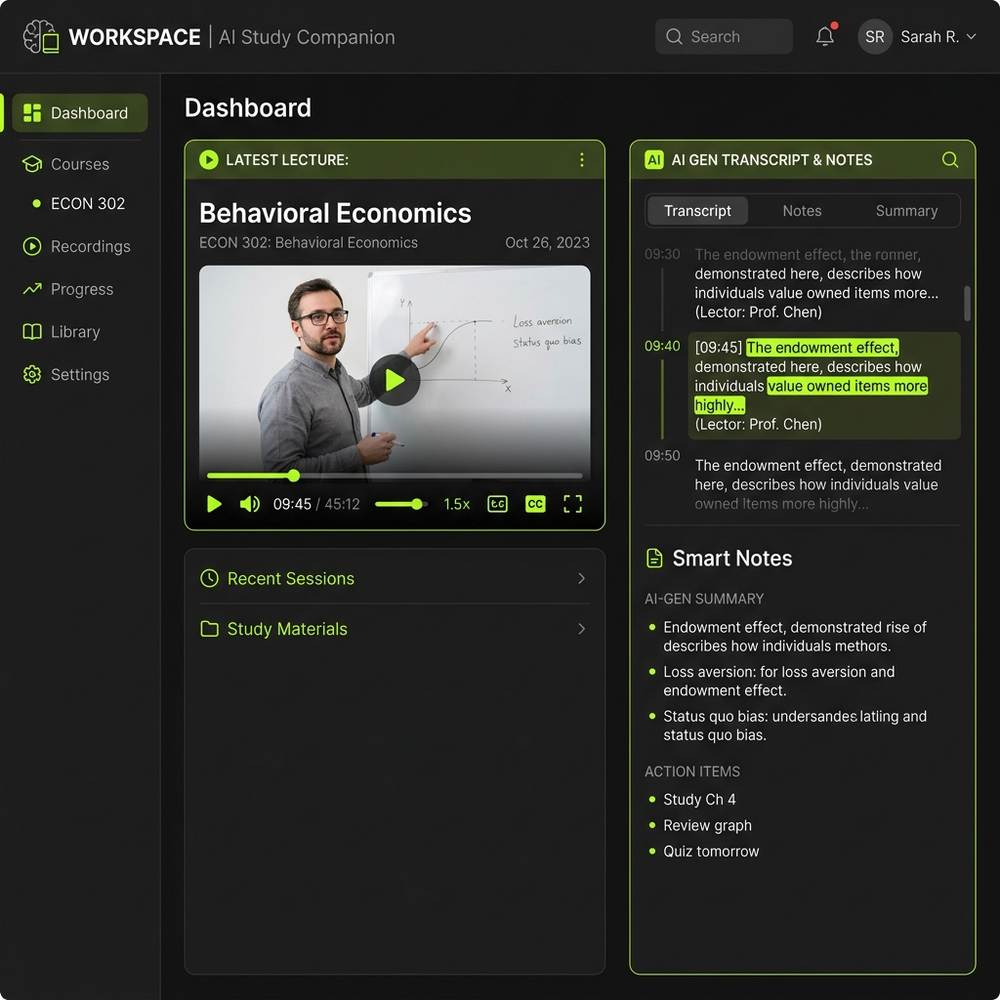
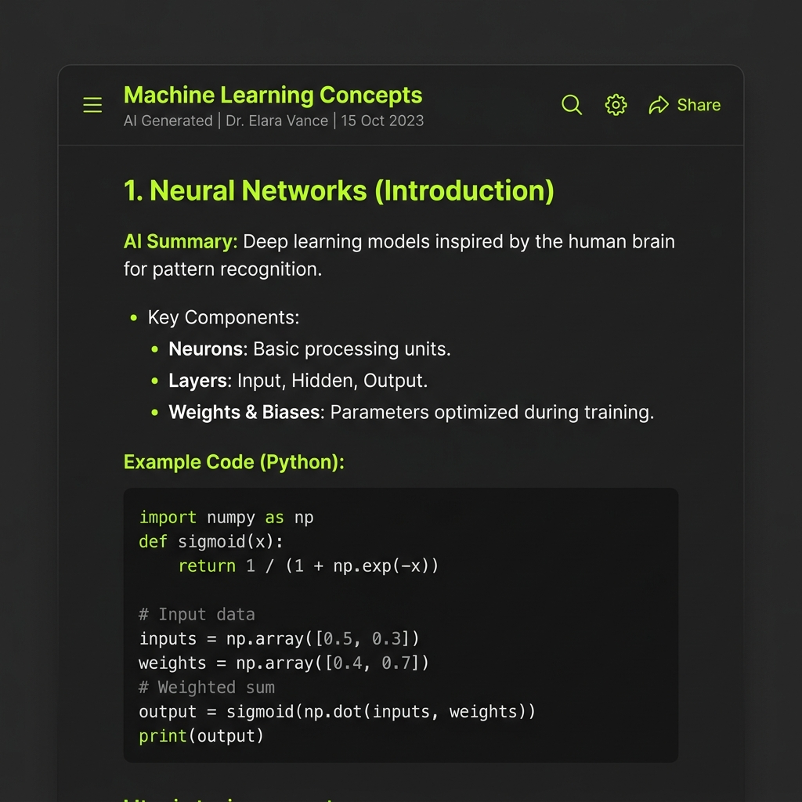
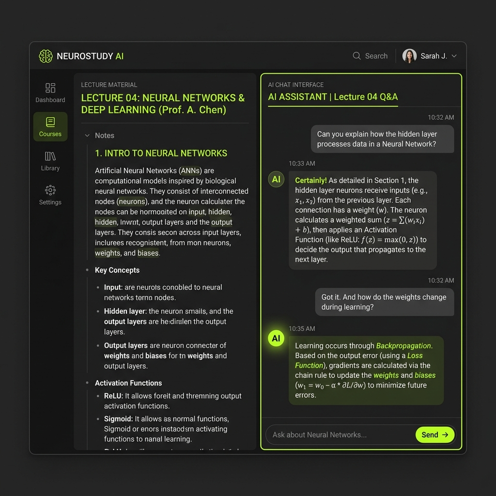
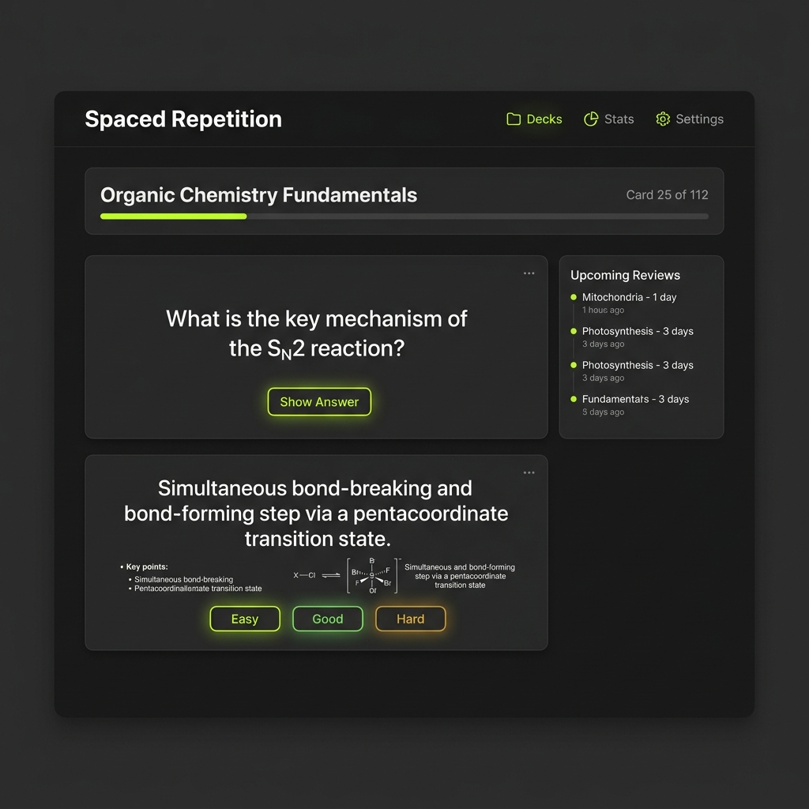
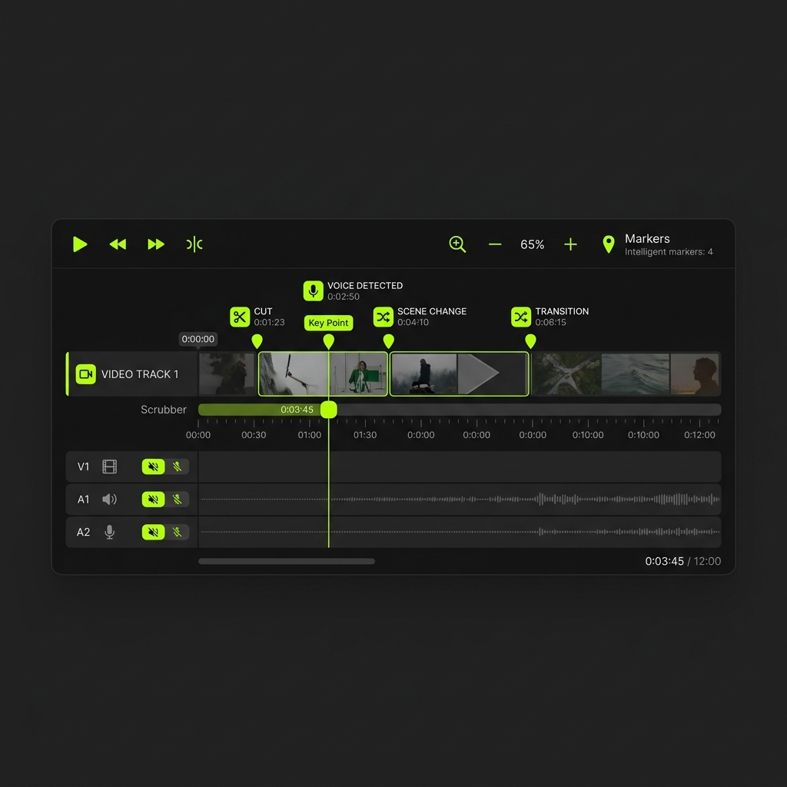

<div align="center">
  

  # BACHAM

  ### The Free, Open-Source, Privacy-First AI Meeting & Lecture Assistant

  **No bots. No cloud. No subscriptions. Your meetings stay on YOUR machine.**

  [](https://github.com/harshabacham/bacham-meeting-assistant)
  [](https://opensource.org/licenses/MIT)
  [](https://tauri.app/)
  [](https://www.rust-lang.org/)
  [](https://react.dev/)
  [](https://chromewebstore.google.com/detail/bacham-%E2%80%94-ai-meeting-lectu/kfngjfenfpaladmjnogmihilchiednfl)

  BACHAM silently captures your desktop audio during meetings or lectures — **nobody in the call knows it's running**. It generates live transcripts, AI summaries, flashcards, and organizes everything into a searchable knowledge base. 100% local. 100% private.

  [**📥 Download**](#-download) • [**✨ Features**](#-features) • [**🏗️ Getting Started**](#-getting-started-for-developers) • [**🤝 Contributing**](#-contributing) • [**📜 License**](#-license)

</div>

<br/>

<!-- Add your demo GIF here when ready -->
<!-- <p align="center"></p> -->

## 🆚 Why BACHAM?

| Feature | BACHAM | Granola ($14/mo) | Fireflies ($19/mo) | Otter.ai ($17/mo) |
|---|:---:|:---:|:---:|:---:|
| **No Meeting Bot** | ✅ | ✅ | ❌ | ❌ |
| **100% Local & Private** | ✅ | ❌ | ❌ | ❌ |
| **Open Source** | ✅ MIT | ❌ | ❌ | ❌ |
| **Chrome Extension** | ✅ | ❌ | ✅ | ✅ |
| **Flashcards & Study Tools** | ✅ | ❌ | ❌ | ❌ |
| **BYOK (Bring Your Own Key)** | ✅ | ❌ | ❌ | ❌ |
| **Price** | **Free forever** | $14/mo | $19/mo | $17/mo |

<br/>

## ✨ Features

<table>
<tr>
<td width="50%">

### 🔴 Invisible Recording
Captures system audio directly — no bot joins your meeting. Works with **Zoom, Google Meet, Teams, any app**.

### 🧠 AI-Powered Notes
Generates real-time transcripts and intelligent summaries using Gemini, OpenAI, or local LLMs via BYOK.

### 🔍 Smart Search
Search hours of meetings with natural language: *"What did we decide about the database migration?"*

</td>
<td width="50%">

### 📓 Flashcards & Cram Sheets
Automatically generates study materials from lectures — perfect for students.

### 🌐 Chrome Extension
Seamlessly capture browser-based calls with one click. Syncs instantly to the desktop app.

### 🔒 Privacy First
Your data never leaves your machine. Everything stored locally in SQLite. Zero cloud dependency.

</td>
</tr>
</table>

<br/>


<details>
<summary><b>🖥️ App Interface & Feature Screenshots</b></summary>

<p align="center">
  
  <br/><em>BACHAM Desktop Dashboard</em>
</p>

<p align="center">
  
  <br/><em>AI-Powered Notes Workspace</em>
</p>

<p align="center">
  
  <br/><em>Ask AI Questions About Your Meetings</em>
</p>

<p align="center">
  
  <br/><em>Auto-Generated Flashcards for Students</em>
</p>

<p align="center">
  
  <br/><em>Timeline & Recording History</em>
</p>

</details>

<br/>

## 📥 Download

### Desktop App (Windows & macOS)

| Platform | Download | Status |
|---|---|---|
| **Windows** (.exe) | [**Download for Windows**](https://bacham.vercel.app) | ✅ Available |
| **macOS** (.dmg) | [**Download for macOS**](https://bacham.vercel.app) | ✅ Available |

### Chrome Extension

Install the extension for seamless browser-based meeting capture:

[](https://chromewebstore.google.com/detail/bacham-%E2%80%94-ai-meeting-lectu/kfngjfenfpaladmjnogmihilchiednfl)

> **Note:** Works with Google Chrome, Brave, and Microsoft Edge.

<br/>

## 🏗️ Getting Started (For Developers)

### Prerequisites

- [Rust](https://www.rust-lang.org/tools/install) (latest stable)
- [Node.js](https://nodejs.org/en/) (v20+) & [pnpm](https://pnpm.io/)
- [Tauri v2 Prerequisites](https://v2.tauri.app/start/prerequisites/) (OS-specific build tools)

### Quick Start

```bash
# Clone the repo
git clone https://github.com/harshabacham/bacham-meeting-assistant.git
cd bacham-meeting-assistant

# Install dependencies
pnpm install

# Run the desktop app
cd apps/desktop
pnpm tauri dev
```

### Project Structure

```
bacham-meeting-assistant/
├── apps/
│   ├── desktop/          # Tauri desktop app (React + Rust)
│   │   ├── src/          # React frontend (Vite + TypeScript + TailwindCSS)
│   │   └── src-tauri/    # Rust backend (audio capture, SQLite, AI providers)
│   ├── extension/        # Chrome extension (browser-based capture)
│   └── landing/          # Landing page (Next.js)
```

## 🏛️ Architecture

| Layer | Technology | Purpose |
|---|---|---|
| **Backend** | Rust + Tauri v2 + SQLite (sqlx) | Audio capture, local processing, file management |
| **Frontend** | React 18 + Vite + TypeScript + TailwindCSS | Beautiful, responsive desktop UI |
| **AI Engine** | Gemini, OpenAI, Local LLMs (BYOK) | Transcription, summarization, flashcard generation |
| **Extension** | Chrome Extension (Manifest V3) | Browser-based meeting capture |
| **Storage** | SQLite (local) | All data stays on your machine |

<br/>

## 🤝 Contributing

We welcome contributions from everyone! Whether you're fixing a typo or building a new feature, your help is appreciated.

1. **Fork** the repository
2. **Create** your feature branch (`git checkout -b feature/AmazingFeature`)
3. **Commit** your changes (`git commit -m 'feat: add AmazingFeature'`)
4. **Push** to the branch (`git push origin feature/AmazingFeature`)
5. **Open** a Pull Request

Check out [`CONTRIBUTING.md`](./CONTRIBUTING.md) for detailed guidelines, architecture overview, and development setup.

### 🏷️ Good First Issues

New to BACHAM? Look for issues tagged with [`good first issue`](https://github.com/harshabacham/bacham-meeting-assistant/issues?q=is%3Aissue+is%3Aopen+label%3A%22good+first+issue%22) — they're great starting points!

<br/>

## 🗺️ Roadmap

- [x] Desktop audio capture (Windows & macOS)
- [x] Chrome extension for browser-based calls
- [x] AI transcription & summaries (BYOK)
- [x] Flashcard & cram sheet generation
- [x] Smart search with embeddings
- [ ] Linux support
- [ ] Real-time collaborative notes
- [ ] Notion / Jira / Linear integrations
- [ ] Local Whisper.cpp for fully offline transcription
- [ ] Mobile companion app

<br/>

## 💬 Community

<!-- Uncomment when you create these -->
<!-- - [Discord](https://discord.gg/your-invite) — Chat with the team and community -->
<!-- - [GitHub Discussions](https://github.com/harshabacham/bacham-meeting-assistant/discussions) — Ideas, Q&A, show & tell -->
- [GitHub Issues](https://github.com/harshabacham/bacham-meeting-assistant/issues) — Bug reports & feature requests
- [Chrome Web Store](https://chromewebstore.google.com/detail/bacham-%E2%80%94-ai-meeting-lectu/kfngjfenfpaladmjnogmihilchiednfl) — Extension reviews & feedback

<br/>

## 📜 License

Distributed under the **MIT License** — free for personal and commercial use. See [`LICENSE`](./LICENSE) for details.

<br/>

---

<div align="center">

  **Built with ❤️ by [Harsh Abacham](https://github.com/harshabacham)**

  If BACHAM saves you time, consider giving it a ⭐ on GitHub — it helps others discover the project!

  [](https://star-history.com/#harshabacham/bacham-meeting-assistant&Date)

</div>
