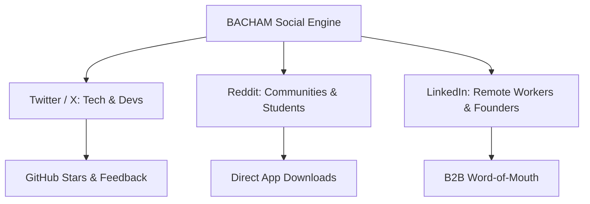

# 🎨 BACHAM Brand Design & Social Media Playbook

A complete guide to establishing an **Apple/Linear-grade design identity** and building a viral, zero-budget social media presence for **BACHAM**.

---

## Part 1: Visual Identity & Design System

To stand out against well-funded incumbents like Granola ($20M+ funding) and Fireflies, BACHAM must look like a **luxury, developer-crafted tool**, not a weekend hobby project.

### 1. Brand Aesthetics & Color Palette
* **Background:** Pitch Black (`#000000` / `#09090B`) — gives the sleek, terminal-first, battery-efficient look.
* **Signature Accent:** Electric Lime / Chartreuse (`#D1E043` / `#CCD948`) — high energy, rebellious, distinct from the generic blue/purple of Silicon Valley enterprise tools.
* **Secondary Accents:**
  - Soft White (`#EDEDED`) for body text
  - Muted Zinc (`#71717A`) for secondary metadata
  - Ambient Glass: `rgba(255, 255, 255, 0.05)` with subtle `1px border-white/10` and `backdrop-blur-md`
* **Typography Pairing:**
  - **Headlines:** High-contrast editorial serif (e.g. *Instrument Serif*, *Playfair Display*, or *Fraunces*) — conveys elegance and thoughtful craft.
  - **UI & Body:** Clean sans-serif (*Geist*, *Inter*, or *SF Pro*) — legible, modern, technical.

### 2. Free Design Tool Stack (Zero Cost)
You don't need Photoshop or expensive agencies. Use this exact workflow:
| Tool | What It's For | Why It's Best | Cost |
|---|---|---|---|
| **[Shots.so](https://shots.so)** | Framing screenshots & mockups | Instant 3D tilt, Apple window frames, dark backgrounds | 100% Free |
| **[Figma](https://figma.com)** | Social banners & carousel posts | Community templates, vector icons | Free Tier |
| **[ScreenToGif](https://www.screentogif.com)** | Quick GIFs for X & GitHub | Portable, light, crisp exports | 100% Free |
| **[CapCut (Web)](https://www.capcut.com)** | 30s TikTok/Reels captions | Auto-subtitles, dynamic zooms | 100% Free |
| **[Fontshare](https://www.fontshare.com)** | Free commercial fonts | High-end typography like Satoshi & Clash Display | 100% Free |

---

## Part 2: Social Media Setup & Platform Strategy

Don't try to be everywhere at once. Focus on the **3 platforms that actually drive downloads for open-source AI tools**:



### 1. Twitter / X (The Developer & AI Community)
* **Target Audience:** Open-source enthusiasts, indie hackers, privacy advocates, remote tech workers.
* **Profile Setup:**
  - **Handle:** `@bacham_ai` or `@bacham_app`
  - **Name:** BACHAM — Open Source AI Notepad
  - **Bio:** `The privacy-first AI meeting & lecture assistant. No bots. 100% local SSD. Free & open source. Built with @tauri_apps & Rust. ⚡ bacham.vercel.app`
  - **Banner:** The hero marketing graphic generated (`bacham_hero_meeting.jpg`) with the dark glass "Listening..." orb.

### 2. Reddit (High-Intent Organic Discovery)
* **Target Subreddits:**
  - `r/opensource` (Show your architecture, zero-cloud promise)
  - `r/privacy` (Highlight: "Why I built a meeting assistant that doesn't upload your audio to third-party clouds")
  - `r/rust` & `r/tauri` (Tech deep dive on dual-stream capture & local SQLite)
  - `r/college` & `r/GetStudying` (Focus on turning 1-hour lectures into 1-click flashcards)
  - `r/remotework` (The anti-bot angle: "No awkward bot joining your team meetings")

### 3. LinkedIn (Professionals Tired of Meeting Fatigue)
* **Tone:** Professional, thoughtful, productivity-focused.
* **Angle:** Privacy compliance, non-intrusive meeting notes, saving 5 hours a week.

---

## Part 3: The 3 Viral Content Pillars

To get consistent engagement, rotate through these three proven narratives:

### Pillar 1: The "Anti-Bot" Privacy Crusader 🛡️
* **The Pain Point:** Everyone hates when an unwanted bot ("Fireflies Notetaker", "OtterPilot") joins a meeting, asks for recording permission, and emails everyone transcripts.
* **The Hook:** *"Stop inviting bots to your confidential meetings."*
* **Content Idea:** A short 15-second screen recording comparing:
  - Left: An awkward bot joining a Zoom/Meet call and everyone staring.
  - Right: BACHAM running silently in the Windows system tray with zero permissions required from other participants.

### Pillar 2: The Student Superpower 🎓
* **The Pain Point:** Students have 3-hour lectures, zero time to review, and can't afford $15/month subscriptions.
* **The Hook:** *"I built an open-source tool that turns university lectures into study flashcards in 3 seconds."*
* **Content Idea:** A 30-second screen capture:
  1. Record 20 seconds of a YouTube lecture.
  2. Click "Generate Flashcards" in BACHAM.
  3. Interactive flashcards instantly appear with Leitner spaced repetition.

### Pillar 3: "Build in Public" Developer Story 🛠️
* **The Pain Point:** Developers respect solo makers taking on VC-funded monopolies.
* **The Hook:** *"How I built a free alternative to Granola ($20M raised) using Rust, Tauri, and React."*
* **Content Idea:** Architecture breakdown, benchmark comparison, or sharing lessons learned building dual-stream audio capture.

---

## Part 4: 5 Ready-to-Publish Launch Posts

### 📝 Post 1: Twitter / X Launch Thread
```text
I got tired of AI meeting bots joining my confidential calls.

So I spent the last few months building an open-source alternative to Granola and Fireflies:

Meet BACHAM ⚡

- 100% Local-first (your data never leaves your machine)
- No bots joining calls
- Dual-stream audio capture
- Turns meetings & lectures into 1-click flashcards
- Free & open source (MIT)

Built with @tauri_apps, Rust, and React.

Check it out on GitHub (stars appreciated!):
https://github.com/harshabacham/bacham-meeting-assistant

Download for Windows & Mac:
https://bacham.vercel.app

What feature should I build next? 👇
```

### 📝 Post 2: Reddit `r/opensource` Post
* **Title:** `I built BACHAM: A 100% open-source, bot-free AI meeting & lecture notepad that stores everything locally on your SSD`
* **Body:**
```text
Hey r/opensource,

Like many of you, I love the idea of AI meeting notes, but I refuse to use tools that send audio to random cloud servers or send an uninvited bot into client calls.

So I built BACHAM — a private, local-first alternative built with Tauri v2, Rust, and React.

Key architectural decisions:
1. No Bots: Captures audio directly from system loopback and mic without needing an external bot to join the call.
2. Local-First: All session metadata, transcripts, and notes are stored in local SQLite.
3. Student Mode: Auto-generates spaced-repetition flashcards from lecture transcripts.
4. Open Source: 100% MIT licensed.

Repository: https://github.com/harshabacham/bacham-meeting-assistant
Website & Binaries: https://bacham.vercel.app

I'd love feedback from the community on performance, local transcription models, and UI ergonomics!
```

### 📝 Post 3: Reddit `r/college` Post
* **Title:** `Free open-source app that automatically turns lecture recordings into study flashcards (no subscription, no bots)`
* **Body:**
```text
Hey everyone,

Instead of paying $10-$20/month for AI study note apps, I built a free open-source desktop tool called BACHAM.

How it works:
- You record your professor's lecture (either in-person or on Zoom/Teams).
- It transcribes and summarizes key points.
- With one click, it extracts key exam questions and turns them into interactive flashcards.

It's completely free, open-source under MIT, and stores everything directly on your laptop so your notes are 100% private.

Download link: https://bacham.vercel.app
Source code: https://github.com/harshabacham/bacham-meeting-assistant

Hope this helps you with midterms!
```

### 📝 Post 4: LinkedIn Founder Post
```text
Why does every AI meeting assistant require an unwanted bot to join your call?

Over the past year, "Notetaker bots" have become the spam of remote work. They interrupt meetings, raise privacy alarms with clients, and store sensitive conversations on proprietary servers.

That's why I created BACHAM.

BACHAM is a free, open-source AI meeting and lecture assistant designed around one core principle: Privacy First.

✅ Zero bots joining your call
✅ 100% local storage on your machine
✅ Works seamlessly with Zoom, Google Meet, and Teams
✅ Dual-purpose: Meeting minutes for pros, study flashcards for students

The project is fully open source (MIT license) on GitHub.

Try the latest release: https://bacham.vercel.app
Source code: https://github.com/harshabacham/bacham-meeting-assistant

How is your team currently handling meeting notes and privacy?
```

### 📝 Post 5: Twitter / X Meme / Quick Hook
```text
Meeting bot etiquette in 2026:

❌ Inviting "Harsha's AI Notetaker Bot" to record a 1-on-1 performance review
❌ Bot emailing 14 people with a hallucinated transcript
❌ Paying $19/mo for cloud transcription

✅ Running BACHAM silently on your SSD
✅ No bots, no cloud, no subscription
✅ 100% open source

bacham.vercel.app
```
