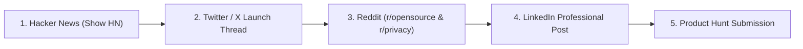

# 🚀 BACHAM — Official Launch Day Campaign Kit

Everything you need to launch **BACHAM** across all major developer and early-adopter communities today.

---

## 📌 Quick Launch Asset Directory
* **Live Website:** [https://bacham.vercel.app](https://bacham.vercel.app)
* **GitHub Repository:** [https://github.com/harshabacham/bacham-meeting-assistant](https://github.com/harshabacham/bacham-meeting-assistant)
* **Chrome Web Store:** [Bacham Chrome Extension](https://chromewebstore.google.com/detail/bacham-%E2%80%94-ai-meeting-lectu/kfngjfenfpaladmjnogmihilchiednfl)
* **Hero Image:** `apps/landing/public/mockups/hero_dashboard.png`
* **Study Deck / Flashcard Image:** `apps/landing/public/mockups/flashcards_ui.png`
* **Notes Workspace Image:** `apps/landing/public/mockups/notes_ui.png`

---

## 🕒 Recommended Launch Sequence (Chronological Order)



---

## 1. 🟠 Hacker News (Show HN)
* **Submission URL:** [https://news.ycombinator.com/submit](https://news.ycombinator.com/submit)
* **Title:** `Show HN: Bacham – Open-source, bot-free meeting and lecture assistant (100% on SSD)`
* **URL:** `https://github.com/harshabacham/bacham-meeting-assistant` *(or leave blank and put in text)*
* **Text / Comment:**

```text
Hi HN! I built Bacham (https://github.com/harshabacham/bacham-meeting-assistant), a free, open-source AI meeting and lecture assistant built with Tauri v2, Rust, and React.

### The problem:
Like many of you, I wanted automated meeting notes and lecture summaries, but I hated two things:
1. The awkward "bot" (Fireflies, Otter, etc.) that insists on joining the call room, making everyone self-conscious.
2. The privacy risk of sending sensitive corporate or personal conversations to a third-party cloud.

### How Bacham works:
- Dual-Stream Loopback: Uses native WASAPI loopback on Windows and CoreAudio tap on macOS to capture incoming speaker audio and outgoing microphone audio simultaneously into distinct channels. No virtual audio cables or drivers needed.
- 100% Local-First Storage: All audio segments, raw transcripts, and structured notes are written directly into an embedded SQLite database on your local SSD.
- BYOK / Local AI: Supports local Ollama / Whisper models, or direct BYOK (Bring Your Own Key) for OpenAI / Gemini with zero middleman servers.
- Student Tools: Includes a 1-click lecture mode that extracts key concepts and generates interactive flashcards.

It's 100% MIT licensed. Binaries for Windows (.exe / .msi) and macOS (.dmg), plus a Chrome Extension, are available here: https://bacham.vercel.app

I would love feedback from the HN community on local transcription pipelines, memory optimization, and UI ergonomics!
```

---

## 2. 🐦 Twitter / X Launch Thread
* **Post from:** Personal Account & `@bacham_ai`
* **Attach Image to Tweet 1:** `apps/landing/public/mockups/hero_dashboard.png`

### Tweet 1 (The Hook):
```text
I got tired of awkward AI meeting bots joining my confidential calls.

So I built an open-source alternative to Granola and Fireflies:

Meet BACHAM ⚡

• 100% Local-first (runs directly on your SSD)
• Zero bots in the call
• Dual-stream audio (mic + system)
• 1-click study flashcards & quizzes
• Free & MIT Licensed

Built with @tauri_apps, Rust, and React. 🧵👇
```

### Tweet 2 (The Problem & Solution):
```text
Why does every AI meeting assistant require a bot? 🤖❌

Traditional tools force an unwanted avatar into your Zoom/Meet call and alert everyone they're being recorded.

BACHAM connects directly to your OS audio loopback. It listens silently from your system tray. Nobody else sees or hears a thing.
```

### Tweet 3 (Student Superpower):
*(Attach: `apps/landing/public/mockups/flashcards_ui.png`)*
```text
Students: You don't need to pay $15/month for study apps. 🎓

BACHAM turns a 1-hour university lecture or technical sync into an interactive study deck with spaced-repetition flashcards in 3 seconds.
```

### Tweet 4 (Architecture & Open Source):
```text
Under the hood:
🦀 Rust backend for low-latency WASAPI / CoreAudio capture
⚡ Tauri v2 for native desktop performance (< 40MB RAM)
💾 Embedded SQLite for local-first storage
🔑 BYOK (Bring Your Own Key) — zero server tracking or telemetry
```

### Tweet 5 (Call to Action):
```text
Get it now:
💻 Website & Downloads: https://bacham.vercel.app
🌐 Chrome Extension: https://chromewebstore.google.com/detail/bacham-%E2%80%94-ai-meeting-lectu/kfngjfenfpaladmjnogmihilchiednfl
⭐ GitHub (stars appreciated!): https://github.com/harshabacham/bacham-meeting-assistant

What feature should we build next? Drop your feedback below! 👇
```

---

## 3. 🔴 Reddit Posts

### A. Subreddit: `r/opensource`
* **Title:** `I built Bacham: A 100% open-source, bot-free AI meeting & lecture assistant that keeps everything on your local SSD`
* **Flair:** `Project` / `Showcase`
* **Body:**
```text
Hey r/opensource!

I wanted to share Bacham, a local-first meeting and lecture assistant I've been building over the past few months.

The motivation:
Most AI meeting tools (Granola, Otter, Fireflies) either charge $15–$20/month or require an uninvited meeting bot to join your call and upload your private voice data to cloud servers.

Bacham takes a fundamentally different approach:
1. No Bots: Hooks directly into system audio loopback (WASAPI on Windows, CoreAudio on Mac) and mic.
2. 100% Local SQLite: Transcripts, audio chunks, and notes stay on your machine.
3. Student Mode: Generates flashcard decks directly from recorded lectures.
4. Privacy First: Zero server telemetry. Run local models or bring your own API keys.

GitHub: https://github.com/harshabacham/bacham-meeting-assistant
Website & Binaries: https://bacham.vercel.app

All code is MIT licensed. Would love your feedback and contributions!
```

---

### B. Subreddit: `r/college` & `r/GetStudying`
* **Title:** `Free open-source tool that turns university lectures into interactive study flashcards (no subscriptions, no bots)`
* **Body:**
```text
Hey everyone,

Instead of paying $10–$20/mo for proprietary AI study apps, I built a completely free and open-source desktop app called BACHAM.

How it works:
1. Open the app during your lecture (in-person or on Zoom/Teams).
2. It records the lecture audio invisibly (no awkward bots joining the call).
3. It transcribes the lecture and generates timestamped notes.
4. With one click, it extracts key exam questions and creates an interactive flashcard deck for studying.

It runs locally on your laptop, so your notes stay completely private.

Download: https://bacham.vercel.app
Chrome Extension: https://chromewebstore.google.com/detail/bacham-%E2%80%94-ai-meeting-lectu/kfngjfenfpaladmjnogmihilchiednfl
Open Source Code: https://github.com/harshabacham/bacham-meeting-assistant

Hope this helps you with exam prep! Let me know what you think.
```

---

### C. Subreddit: `r/rust` & `r/tauri`
* **Title:** `Building Bacham: A low-latency dual-stream audio capture meeting notepad with Tauri v2, Rust, and React`
* **Body:**
```text
Hey everyone!

I just open-sourced Bacham (https://github.com/harshabacham/bacham-meeting-assistant), a desktop AI meeting assistant built with Tauri v2, Rust, and React.

Architecture details:
- Audio pipeline: Rust-native WASAPI loopback capture on Windows and CoreAudio capture on macOS. Captures system output and mic on synchronized tracks with negligible CPU overhead.
- Storage: sqlx with SQLite on-device.
- Frontend: React 18, Vite, TailwindCSS, Framer Motion.
- Bundle size: ~20MB installer vs >150MB Electron alternatives.

Check out the repo or download the release at https://bacham.vercel.app. Would love feedback from the Rust/Tauri community!
```

---

## 4. 💼 LinkedIn Founder Post
* **Attach Image:** `apps/landing/public/mockups/hero_dashboard.png`

```text
Why does every AI meeting assistant require an unwanted bot to join your call?

Over the past two years, "Notetaker bots" have become the spam of remote work. They disrupt meetings, trigger security flags for enterprise clients, and upload confidential discussions to proprietary servers.

That's why I created BACHAM.

BACHAM is a free, open-source AI meeting and lecture notepad designed around one core principle: Privacy First.

✅ Zero bots joining calls (runs silently via OS audio loopback)
✅ 100% local storage on your SSD (SQLite)
✅ Dual-stream capture for speaker + mic separation
✅ Works with Zoom, Teams, Google Meet, or in-person lectures
✅ Built for both professionals (action items) and students (1-click study flashcards)

The project is 100% open source under the MIT license.

🌐 Try it: https://bacham.vercel.app
⭐ GitHub: https://github.com/harshabacham/bacham-meeting-assistant

How is your team currently approaching meeting privacy and AI notetakers?
```

---

## 5. 🐱 Product Hunt Launch Listing
* **Name:** BACHAM
* **Tagline:** The free, open-source AI meeting notepad on your SSD (No bots)
* **Categories:** Productivity, Artificial Intelligence, Developer Tools, Open Source
* **Website:** `https://bacham.vercel.app`
* **Maker First Comment:**

```text
Hey Product Hunt! 👋

I'm Harsha, the maker of BACHAM.

I built Bacham because I wanted AI meeting notes without the two biggest frustrations of modern tools:
1. Having an awkward bot join my meetings and alert clients.
2. Handing over sensitive conversational audio to cloud companies.

Bacham hooks directly into your OS audio driver to record both speaker audio and your microphone silently. Everything is indexed locally into SQLite on your machine. You can even generate study flashcards from recorded lectures in one click.

It is 100% free, MIT open source, and available for Windows, macOS, and Chrome.

I'd love to hear your thoughts, feedback, and feature requests! 🚀
```

---

## ⚡ Launch Day Pro-Tips
1. **Engage Rapidly:** Reply to every single comment on Hacker News, Reddit, and Twitter within 10–15 minutes. High initial engagement pushes the post to the top of the algorithm.
2. **Windows SmartScreen Defense:** If any Windows user asks about Microsoft Defender SmartScreen, remind them that the app is 100% open-source MIT, the website features a step-by-step SmartScreen guide ("More info" -> "Run anyway"), and they can inspect all code on GitHub.
3. **Ask for GitHub Stars:** GitHub stars provide social proof. Always include the GitHub link in post bios and replies!
